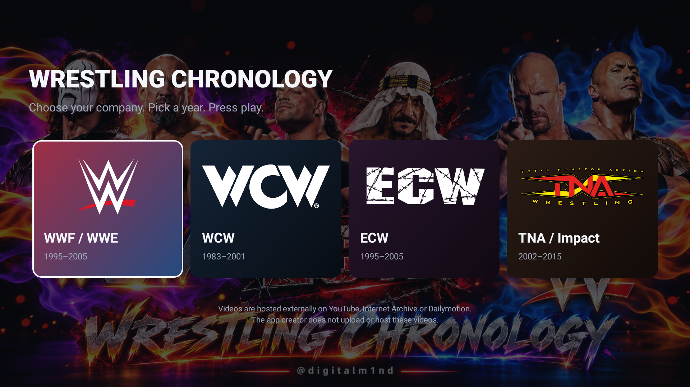

# Wrestling Chronology

## Install with Downloader on Fire TV

**Downloader code: `2909774`**

**Short URL: [aftv.news/2909774](https://aftv.news/2909774)**

1. Install and open **Downloader by AFTVnews** on your Fire TV or Fire Stick.
2. Enter **`2909774`** in Downloader's URL field and select **Go**.
3. Download the APK. If prompted, allow Downloader to install unknown apps in Fire TV settings, then return and select **Install**.
4. Open **Wrestling Chronology** from your apps.

[Download the latest APK directly](https://github.com/deklol/Wrestling-Chronology/releases/latest/download/Wrestling-Chronology.apk)

For future updates, use the same Downloader code or check **Settings > Update app**. Install updates over the existing app to preserve viewing history.

A remote-friendly Fire TV app for watching full wrestling shows in chronological order. Choose WWF/WWE, WCW, ECW, TNA or AEW, select a year, and play the available shows and events in one queue.

- Separate company libraries, colour schemes and artwork, including AEW.
- Year → All → Filter shows: select the programmes included in chronological autoplay.
- Built-in streaming player for YouTube, Internet Archive and Dailymotion.
- Optional 4:3-to-16:9 horizontal stretch, available in the player and global Settings.
- Chronological autoplay, multipart recordings, resume and watched progress.
- Company home previews with saved episode details, artwork and viewing progress.
- Jan–Dec shortcuts inside each year to jump through its chronological timeline.
- Latest discoveries, dedicated years, programme filters, PPVs and search.
- Small source checks against GitHub; changed JSON libraries download independently of app updates.

| Company | Years | Bundled broadcasts |
|---|---|---:|
| WWF / WWE | 1985–2026 | 8,467 |
| WCW | 1985–2001 | 2,044 |
| ECW | 1995–2005 | 422 |
| TNA / Impact | 2002–2026 | 1,855 |
| AEW | 2019–2026 | 993 |

These are sourced broadcasts, not a claim that every historical show exists or that every recording has been watched end to end. Provider availability can change. Videos are streamed from external hosts; this repository does not contain or upload video recordings.

Requires Fire OS 6 / Android 7.1 or newer. The first test build was checked on an AFTSS Fire TV Stick running Android API 28. No PC or Google Play Services is required during use.

[Build the app](docs/BUILDING.md) · [Manage sources](docs/SOURCES.md) · [Source updates](docs/UPDATES.md) · [Validation](docs/VALIDATION.md)

The software is GPL-3.0; third-party software, logos, artwork and hosted media retain their own rights. See [third-party notices](THIRD_PARTY_NOTICES.md).

Created by [digitalm1nd](https://x.com/digitalm1nd).
